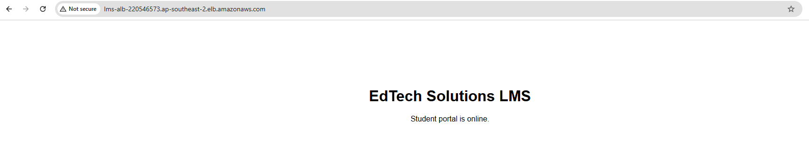

# Project 1: ECS Fargate LMS Troubleshooting

A containerised LMS front end (nginx) on ECS Fargate behind an Application Load Balancer, in ap-southeast-2. I planted four faults, reproduced each one, diagnosed it from logs and CLI output, and fixed it one at a time.

**Stack:** ECR, ECS Fargate (awsvpc), ALB, target group, security groups, CloudWatch Logs.

## Incident 1: Tasks never start
- **Symptom:** Tasks cycle Pending then Stopped. The target group has 0 registered targets.
- **Root cause:** Tasks had no public IP and the subnets have no NAT or VPC endpoint, so they could not reach the ECR API.
- **Evidence:** `ResourceInitializationError ... GetAuthorizationToken ... dial tcp ...:443: i/o timeout` from `aws ecs describe-tasks`.
- **Fix:** `update-service` with `assignPublicIp=ENABLED --force-new-deployment`.
- **Prevention:** Use private subnets with a NAT gateway or ECR/S3/Logs VPC endpoints in production.

## Incident 2: Targets unhealthy, Target.Timeout
- **Symptom:** Tasks run but targets show `unhealthy / Target.Timeout`.
- **Root cause:** Task security group allowed port 80, but the app and target group use 8080.
- **Evidence:** Container logs showed nginx healthy; the task SG had only a TCP 80 rule.
- **Fix:** Added an inbound TCP 8080 rule on the task SG, sourced from the ALB SG.
- **Prevention:** Keep the container port, target group port and SG rule in one documented place.

## Incident 3: Targets unhealthy, 404
- **Symptom:** `Target.ResponseCodeMismatch: Health checks failed with these codes: [404]`.
- **Root cause:** The target group probed `/health`, but nginx serves `/healthz`.
- **Evidence:** `describe-target-groups` showed path `/health`; `nginx.conf` defines `location /healthz`.
- **Fix:** `modify-target-group --health-check-path /healthz`.
- **Prevention:** Add a health check test to the deployment pipeline.

## Incident 4: Site unreachable though healthy
- **Symptom:** Targets healthy, but browser and curl time out against the ALB DNS name.
- **Root cause:** The ALB security group had no inbound rule for port 80.
- **Evidence:** `describe-security-groups` returned `IpPermissions: []`.
- **Fix:** Allowed inbound TCP 80 from 0.0.0.0/0 on the ALB SG.
- **Prevention:** Review SGs on every new internet-facing load balancer; add HTTPS later.

## Method
Reproduce, gather evidence, state the root cause in one line, fix one thing, re-test, then move on.

